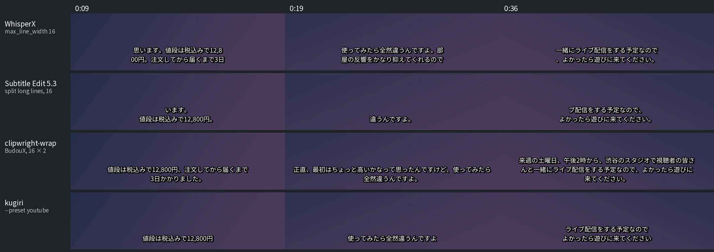
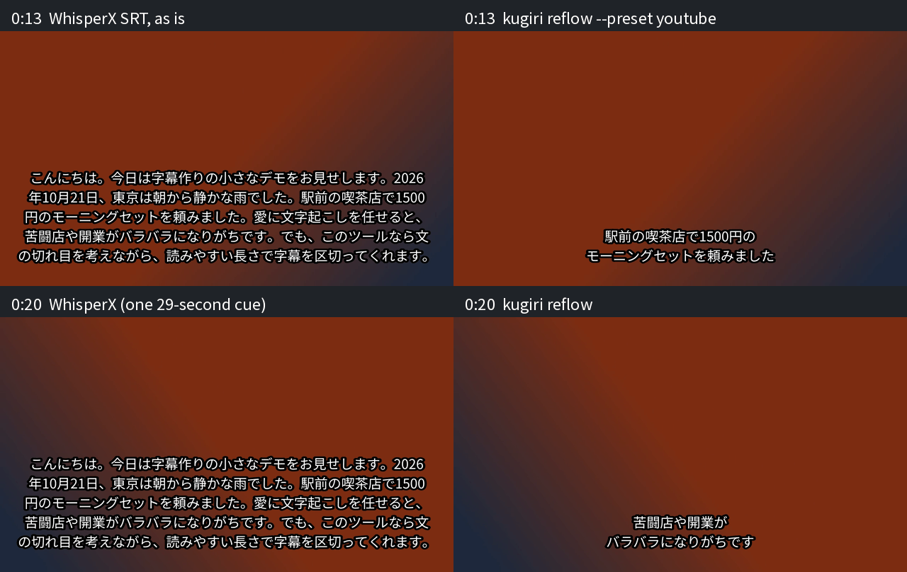

<div align="center">


<p>
  <a href="LICENSE"></a>
  
  
  <a href="#-use-it-from-your-ai-agent-mcp"></a>
  <a href="#-use-it-from-your-ai-agent-mcp"></a>
  
  <a href="https://github.com/kanaworksai-hue/kugiri/stargazers"></a>
</p>

<p><a href="https://github.com/kanaworksai-hue"></a>&nbsp;<a href="https://github.com/kanaworksai-hue"><b>A KanaWorks_AI project</b></a></p>

[日本語](README.md) | **English** | [简体中文](README.zh-CN.md)

[Quick start](#-quick-start) · [How it compares](#-how-it-compares) · [Web UI](#-web-ui) · [MCP](#-use-it-from-your-ai-agent-mcp) · [Fix other tools' subtitles](#-fix-subtitles-made-by-other-tools) · [⭐ Star](#-like-it-star-it)

</div>

**動画を入れるだけで、日本語として自然な区切りの字幕を。台本がなくても書き起こしから、台本があれば一文字単位でぴったり。**

**kugiri** (区切り, "where to cut") makes Japanese subtitles from a video or audio file, **with or without a script**.
No script? It transcribes the speech first (Qwen3-ASR, with punctuation) and you can fix the words afterwards.
Have a script? It is aligned to the audio character by character. Either way, the lines break where Japanese
breaks (at phrase boundaries, with numbers kept together with their units), and you get SRT / VTT / ASS (with furigana if you like).
Everything runs on your own Mac: in the browser, from your AI agent, or on the command line.

## ✨ Highlights

<table>
<tr>
<td align="center" width="25%">🎙️<br><b>Script optional</b><br><sub>Transcribes Japanese speech with punctuation, or aligns your script to the audio character by character</sub></td>
<td align="center" width="25%">✂️<br><b>Natural line breaks</b><br><sub>Breaks at Japanese phrase boundaries with kinsoku rules; numbers stay with their units</sub></td>
<td align="center" width="25%">🤖<br><b>Web UI + MCP + CLI</b><br><sub>Same engine in the browser, in Claude Code (plugin) and other MCP clients, and in your scripts</sub></td>
<td align="center" width="25%">🔒<br><b>Local</b><br><sub>Runs on Apple Silicon. Your video is never uploaded; no API key, nothing to pay</sub></td>
</tr>
</table>

- **Furigana:** on every kanji word, or only on hard words (outside the 常用漢字表), or for children by school grade.
- **Fixes other tools' subtitles:** `kugiri reflow` re-breaks SRT / VTT / JSON from Vrew, CapCut, Premiere,
  DaVinci Resolve, Subtitle Edit, WhisperX or YouTube auto-captions, without any model.
- **Quality check:** places where the script and the audio disagree are listed with timestamps.
- **Presets:** YouTube, vertical Shorts / TikTok, Netflix Japanese style.

Status: beta. **This first release supports macOS on Apple Silicon only** (M1 or later, macOS 14+).

## 🚀 Quick start

You need [uv](https://docs.astral.sh/uv/getting-started/installation/) (`brew install uv`) and, for anything
other than WAV, ffmpeg (`brew install ffmpeg`). Then:

```sh
uvx --python 3.12 --from 'kugiri[all]' kugiri web     # opens the Web UI at http://localhost:7790/
```

The first start downloads about 1 GB of Python packages (PyTorch) and then the models (1.3 GB for alignment,
4.1 GB for transcription), so give it a few minutes; the page shows the download progress. After that everything
runs offline on your Mac. Drop a video, paste the script if you have one (or leave it empty to transcribe), and
download the subtitles.

## 📊 How it compares

Most subtitle tools break Japanese lines by counting characters. kugiri breaks them at Japanese phrase boundaries:
no 、。」 at the start of a line, no number cut away from its unit, one sentence per cue where possible.



*Our own demo clip (synthetic voice), every tool limited to 16 characters × 2 lines, rendered with libass.
WhisperX 3.8 (large-v3-turbo): `--max_line_width 16 --max_line_count 2`. Subtitle Edit 5.3: its "Split/break long lines" on the
WhisperX transcript, line length set to 16 (the default is 43). clipwright-wrap 0.3: default settings (16 × 2),
given one sentence per cue, because it only re-wraps lines inside the cues it gets and never splits a cue.
kugiri: `kugiri reflow` on the WhisperX JSON. Breaks to look at: `12,8｜00円`, a line starting with `、` (WhisperX),
`思｜います`, `ライ｜ブ配信` (Subtitle Edit), lines too long for the frame (clipwright-wrap).*

**Timing.** Aligning a script to speech, measured on 24 one-minute TEDx talks in Japanese with human-timed
subtitles ([TEDxJP-10K](https://github.com/laboroai/TEDxJP-10K)): how far each cue's start and end are from the
human timing.

| | mean error | starts within 300 ms | ends within 300 ms |
|---|---|---|---|
| kugiri `align` | 149 ms | 96% | 82% |
| WhisperX alignment (`wav2vec2-large-xlsr-53-japanese`), same text | 324 ms | 91% | 37% |

Both get the same one-minute text and audio (WhisperX as a single segment, without Whisper's own rough segment
times). The human cues include a little silence before and after the speech, so part of every tool's error is the
reference itself. Subtitle Edit 5 can also align a plain-text script; it times each line's start with a forced
aligner and sets the end from reading speed, so its line ends are not taken from the audio.

## 🧭 What it does

- `kugiri align`: audio or video → naturally broken Japanese subtitles. Without a script it transcribes the speech
  (Qwen3-ASR, with punctuation); with a script it skips that step. Either text is then aligned to the audio
  character by character (omniASR CTC 300M forced alignment, whole file in one pass, no manual splitting).
- `kugiri reflow`: model-free line-breaking engine for subtitles that already have timings — including
  subtitles made by other tools (Vrew, CapCut, Premiere, DaVinci Resolve, Subtitle Edit, WhisperX, YouTube).
- Export SRT / WebVTT / ASS / timeline JSON.

### Alignment

- The whole file is aligned in one Viterbi pass, so long recordings need no script↔audio chunk matching.
  A 30-minute file fits comfortably in a 16 GB Mac (checkpointed Viterbi, only the script's characters are kept).
- Numbers, Latin words (`AI`, `iPhone`), characters outside the model's vocabulary and user-dictionary words are
  aligned through their readings (`2026` → にせんにじゅうろく) and reported as one unit with `reading`.
- Phrase-final timings are corrected with the audio envelope (CTC spikes end too early on drawn-out endings).
- Quality check: stretches where the script and the audio disagree (missing / extra text, crosstalk, noise)
  are listed with timestamps and the affected cues are flagged `low_confidence` in the JSON.

### Transcription (no script)

- Qwen3-ASR 1.7B (Apache-2.0) through the native Hugging Face `transformers` implementation, with
  punctuation (、。？). Audio is cut at pauses into ≤20-second chunks that are decoded in batches.
- Hallucination guards: per-chunk token limits, repetition and speaking-rate checks. A suspicious chunk falls
  back to the alignment model's own greedy transcript (a CTC model cannot invent text) and is flagged.
- `--save-script` writes the transcript one sentence per line: fix it and re-run with `--script`.

### Line breaking

- Kinsoku rules (no 、。っー」 at line start, no 「（ at line end), numbers with units never split
  (`2026年10月20日`, `1,500円`, `2.5GB`), short brackets kept together.
- Bunsetsu-aware break costs from SudachiPy, two-level dynamic programming (cue segmentation × line wrap),
  "one sentence per cue" preference, also for unpunctuated speech (〜ました|〜です).
- Timing rules: min/max duration, cues stay up long enough to read (up to 1.5 s after speech ends),
  2-frame gap, short gaps closed, frame snapping.
- Readings with pyopenjtalk-plus; user dictionary can override readings and forbid splits.
- Furigana: ASS (positioned ruby lines, works in libass players; positions use Noto Sans JP metrics by default,
  pass `--font-file` for other fonts), WebVTT `<ruby>` (opt-in; browsers only, ffmpeg-based players show the
  reading after the kanji). `--ruby all` marks every kanji word; `--ruby hard` only words that are hard to
  read — kanji outside the 常用漢字表 or readings it does not list (薔薇, 流石, 辛い = つらい) — and
  `--ruby-grade N` also marks kanji not yet learned by elementary-school grade N (学年別漢字配当表), for
  children's and learners' content. `--ruby-once` marks each word only the first time it appears (Netflix style).
- SRT output replaces `< > { } \` with full-width forms, because most players treat them as markup.

## 📦 Install

Needs macOS 14 or later on Apple Silicon and Python 3.11 or later. With [uv](https://docs.astral.sh/uv/) you
can try it in one line, nothing to set up:

```sh
uvx --python 3.12 --from 'kugiri[all]' kugiri web   # opens the Web UI at http://localhost:7790/
```

`--python 3.12` makes uv fetch its own Python when the Mac only has the system Python 3.9 (any 3.11+ works).
To keep the `kugiri` command:

```sh
uv tool install --python 3.12 'kugiri[all]'   # or, in a Python 3.11+ environment: pip install 'kugiri[all]'
uv tool update-shell                          # once, if uv says ~/.local/bin is not on PATH
kugiri --help
```

| install | what you get |
|---|---|
| `kugiri` | `kugiri reflow` (fix / re-break existing subtitles), `reading`, `presets`. No model; about 110 MB download (dictionaries) |
| `kugiri[align]` | + `kugiri align` with a script (PyTorch) |
| `kugiri[asr]` | + transcription when there is no script |
| `kugiri[web]` / `kugiri[mcp]` | + Web UI / MCP server (both include `asr`) |
| `kugiri[all]` | everything, plus fonttools for exact furigana positions in ASS |

With PyTorch the packages are about 1 GB; the first `uvx` / install takes a few minutes. Intel Macs cannot
install the PyTorch extras (PyTorch no longer ships Intel macOS builds); plain `kugiri` (`reflow`) works there.

**Models are downloaded on first use, once**, and then work offline:

| model | used for | size | stored in |
|---|---|---|---|
| omniASR CTC 300M v2 (Meta, Apache-2.0) | alignment (`align`, Web UI, MCP) | 1.3 GB | `~/.cache/kugiri/models` (`KUGIRI_MODEL_DIR`) |
| Qwen3-ASR 1.7B (Apache-2.0) | transcription without a script | 4.1 GB | Hugging Face cache (`HF_HOME`) |
| Qwen3-ASR 0.6B (`--asr-model qwen3-0.6b`) | faster, less memory | 1.6 GB | Hugging Face cache |

The terminal, the Web UI and MCP progress messages show what is being downloaded and how far it is. An
interrupted download resumes where it stopped when you run again. Mirrors: `KUGIRI_MODEL_URL` (base URL of the
omniASR files) and `HF_ENDPOINT`. `kugiri web` downloads and loads both models when it starts (`--warm none`
to wait for the first job, `--warm qwen3-0.6b` for the smaller recognizer).

The models run in plain PyTorch (no fairseq2) on the Apple GPU (MPS; `--device cpu` also works, slowly).
A 16 GB Apple Silicon Mac is enough, also for long recordings. WAV is read directly; other audio/video formats need `ffmpeg` on `PATH` (`brew install ffmpeg`,
or point `KUGIRI_FFMPEG` at it). Linux, Windows and NVIDIA GPUs (`--device cuda`) are not tested yet.

## 🌐 Web UI

```sh
kugiri web                 # opens http://localhost:7790/ (only this machine can connect)
```

1. Drop a video or audio file. A script is optional (paste it or load a `.txt`); without one the audio is
   transcribed first.
2. Pick a preset (YouTube landscape / vertical Shorts / Netflix), the recognition model and furigana.
3. Progress is shown per step (transcription → alignment → line breaks). Jobs run one at a time; the rest wait
   in a queue, and the page stays usable while a long file is processed.
4. The result page plays the video with the subtitles on top. Edit any line in the list, then **re-break lines**
   (instant) or **re-align with edits** (your text becomes the script, timings are recomputed).
5. "Check these" lists the places where the script and the audio seem to disagree; click one to jump there.
6. The transcript / script tab lets you download the transcript, fix it (or load a `.txt`) and re-align with it.
   The user dictionary (readings, words that must not be split) is edited in the header.
7. Download SRT / VTT / ASS / JSON / script `.txt`.

The models are loaded when the server starts and stay in memory (the next file starts immediately).
`--warm qwen3-0.6b` / `--warm none` loads the smaller recognizer or nothing up front. Uploaded files and the
user dictionary live in `~/.cache/kugiri/web` (`KUGIRI_HOME` or `--data-dir` to change; jobs older than 7 days
are removed at start-up). The UI is in Japanese and English. The server only answers requests addressed to
localhost and rejects changes coming from other websites; `--host 0.0.0.0` opens it to your network (no login).

## 🤖 Use it from your AI agent (MCP)

`kugiri mcp` is an MCP server (stdio, official Python SDK). Tools:

| tool | what it does |
|---|---|
| `align` | audio/video (+ optional script) → subtitle files; returns output paths, cue count and the quality report |
| `transcribe` | speech → text only (one sentence per line, written to a `.txt`) |
| `job_status` | state of a job started with `wait=false` |
| `reflow` | re-segment / re-wrap existing SRT / VTT / JSON subtitles (optionally with the agent's sentence marks) |
| `break_candidates` | the allowed break points, numbered, so the agent can mark sentence ends by meaning |
| `reading` | kana reading of a sentence (checks the user dictionary) |
| `presets` | parameters of each preset |

Inputs and outputs are local file paths. By default `align` writes `<name>.kugiri.srt` (and
`<name>.kugiri.script.txt` when it transcribed) next to the audio, so your own `<name>.srt` is never replaced;
an explicit `output` path is overwritten. Long jobs send MCP progress notifications; if your client times out on
long calls, pass `wait=false` and poll `job_status`. Models are loaded on the first call and stay loaded.

**Install the Python packages once first.** MCP clients only wait about 30 seconds for a server to start,
and the first `uvx` run installs about 1 GB (PyTorch), which takes longer:

```sh
uvx --python 3.12 --from 'kugiri[mcp]' kugiri --version
```

The models are downloaded on the first `align` / `transcribe` call (see [Install](#-install)); that call simply
takes longer, with progress messages.

**Claude Code** — as a plugin (one step, Claude Code 2.1.275 or later):

```
/plugin install kugiri --marketplace kanaworksai-hue/kugiri
```

Older versions: `/plugin marketplace add kanaworksai-hue/kugiri`, then `/plugin install kugiri@kugiri`.
Or add only the MCP server:

```sh
claude mcp add kugiri -- uvx --python 3.12 --from 'kugiri[mcp]' kugiri mcp
claude mcp add kugiri -- kugiri mcp          # if you installed it with uv tool install / pip
```

**Claude Desktop** (`~/Library/Application Support/Claude/claude_desktop_config.json`):

```json
{
  "mcpServers": {
    "kugiri": {
      "command": "/absolute/path/to/uvx",
      "args": ["--python", "3.12", "--from", "kugiri[mcp]", "kugiri", "mcp"],
      "env": {"PATH": "/opt/homebrew/bin:/usr/local/bin:/usr/bin:/bin"}
    }
  }
}
```

Claude Desktop starts servers with almost no environment: use the absolute path of `uvx` (`which uvx`), and
make sure `PATH` contains `ffmpeg` for non-WAV input. If you keep the models somewhere else, add
`"HF_HOME"` / `"KUGIRI_MODEL_DIR"` to `env` as well.

**Other MCP clients** (Cursor, VS Code, Codex CLI, …) run the same stdio command,
`uvx --python 3.12 --from 'kugiri[mcp]' kugiri mcp`. Apps started from the Dock may not see `~/.local/bin`,
so the absolute path of `uvx` is safest everywhere. Cursor (`.cursor/mcp.json`) uses the Claude Desktop format
above; VS Code (`.vscode/mcp.json`):

```json
{"servers": {"kugiri": {"type": "stdio", "command": "uvx", "args": ["--python", "3.12", "--from", "kugiri[mcp]", "kugiri", "mcp"]}}}
```

Codex CLI (`~/.codex/config.toml`; a first `align` with a model download, or a long file, takes longer than
Codex's default tool timeout):

```toml
[mcp_servers.kugiri]
command = "uvx"
args = ["--python", "3.12", "--from", "kugiri[mcp]", "kugiri", "mcp"]
startup_timeout_sec = 60
tool_timeout_sec = 1800
```

Then ask, for example: "Make YouTube subtitles for ~/Movies/talk.mp4 with the script ~/Movies/talk.txt, and an
ASS file with furigana."

### Let the agent read for meaning

Spoken Japanese often has no punctuation (「〜ですねじゃあ次は〜」), and no rule can tell where one sentence ends and
the next begins. With MCP the agent can: `break_candidates` lists every break point the rules allow, one phrase
per line with a number; the agent marks the sentence ends and passes them to `reflow`
(`hints_key`, `sentence`, rarely `keep`). kugiri still does the cutting, wrapping and timing, and the agent can only
choose among allowed points, so kinsoku, numbers with units and brackets stay intact. It uses the agent's own model;
kugiri calls no LLM API. For audio, run `align` with a `.json` output first and reflow that JSON. Results depend on the
agent's model: a strong model such as Claude Opus reads the sentence boundaries noticeably better than a smaller
one, which gives about the same result as kugiri's rules alone. Ask, for example:
"Fix the line breaks of ~/Movies/talk.srt with kugiri, marking the sentence ends yourself."

## 🩹 Fix subtitles made by other tools

Already have Japanese subtitles from another tool? `kugiri reflow` turns them into properly broken Japanese
subtitles in one command. It does not recognise speech again: it only re-cuts the cues, re-wraps the lines and
applies the timing rules, so it needs no model and takes a second (plain `kugiri` without extras is enough:
`uvx --python 3.12 kugiri reflow …`).

```sh
kugiri reflow from-vrew.srt --preset youtube -o fixed.srt
kugiri reflow whisperx-output.json --preset vertical -o shorts.srt   # WhisperX JSON: uses its per-character times
kugiri reflow video.ja.vtt --preset youtube -o fixed.srt            # YouTube auto-captions (yt-dlp --write-auto-subs)
```



*Our own demo clip (synthetic voice). Left: WhisperX's SRT as it comes out (Japanese gets no line limit by
default, so this is a single 29-second cue). Right: the same file after `kugiri reflow --preset youtube`.
Recognition errors (苦闘店 for 句読点) are not touched — fix the words in the result, or use `kugiri align`
with a script.*

What the input side copes with:

| input | handled |
|---|---|
| very long one-line cues, cues of a few characters, no punctuation (Vrew, CapCut, Premiere, Resolve) | joined and cut again at Japanese phrase boundaries, one sentence per cue where possible |
| YouTube auto-captions (`.vtt`) | rolling two-line captions are de-duplicated, 10 ms transition cues dropped, the `<c>` word timings are used |
| WhisperX / openai-whisper / stable-ts JSON, whisper.cpp JSON | `segments[].words` become character timings (untimed digits follow their neighbours), `speaker` is kept |
| word-highlight SRT (WhisperX `--highlight_words`, karaoke-style exports) | the repeated cues are merged into one |
| Japanese with spaces between words (今日 は 天気 が) | spaces removed (only when the whole file is spaced like that; Netflix-style spaces that stand in for 、。 are kept) |
| `.ass` / `.ssa` (Aegisub, Subtitle Edit) | `Dialogue` events with `\N` line breaks; override tags, comments and drawings are ignored; `Name` = speaker |
| UTF-8 with or without BOM, UTF-16, Shift_JIS; CRLF; stray trailing spaces | read as they are |
| `（拍手）` / `[音楽]` / `♪～` cues, two-speaker cues (`-行こう` / `-うん`), `>> 名前` | kept as separate cues; a two-speaker cue that does not fit is split into one cue per speaker |

Formats from Vrew, CapCut, Premiere Pro and DaVinci Resolve were not available to us as real files; the test
inputs for them (`tests/golden/input/`) are written by hand from their documented / reported behaviour (long
or very short cues without punctuation, trailing spaces, BOM, CRLF). WhisperX and YouTube auto-captions were
checked with real output. Please open an issue with a sample if a file from your tool comes out wrong.

## ⌨️ Usage

```sh
kugiri align talk.wav --script talk.txt -o talk.srt        # one paragraph per line in talk.txt
kugiri align talk.mp4 --script talk.txt --preset vertical -o talk.ass --ruby all
kugiri align talk.wav --script talk.txt -o talk.json       # timeline JSON with per-character times + quality report
kugiri align interview.wav --script script.txt --speakers -o out.vtt   # "名前：…" / ">> 名前" line prefixes
kugiri align talk.wav -o draft.srt --save-script draft.txt # no script: transcribe (Qwen3-ASR) → align → break lines
kugiri reflow in.srt --preset youtube -o out.srt          # re-segment + re-wrap, apply timing rules
kugiri reflow in.vtt --preset netflix --mode wrap -o out.vtt   # keep every cue and its timing, only re-wrap
kugiri reflow in.srt --preset vertical --ruby all --dict words.tsv -o out.ass
kugiri reflow in.srt --ruby hard --ruby-once -o out.ass    # furigana only on hard words, first time only
kugiri reflow in.srt --ruby hard --ruby-grade 3 -o out.vtt # kids: kanji a 3rd-grader has not learned yet
kugiri reflow in.srt --show-breaks > breaks.txt           # numbered break points (what MCP break_candidates shows)
kugiri reflow in.srt --hints marks.json -o out.srt        # {"key": …, "sentence": [3, 9, …], "keep": []}
kugiri reading "東京の夜は静かです" --tokens
kugiri presets
kugiri web                                            # local Web UI
kugiri mcp                                            # MCP server (stdio)
```

Presets:

| preset | chars/line | lines | reading speed | duration | fps |
|---|---|---|---|---|---|
| `netflix` | 13 | 2 | 4 cps | 0.5–7 s | 24 |
| `youtube` | 16 | 2 | 6 cps | 0.7–7 s | 30 |
| `vertical` (Shorts / TikTok) | 10 | 2 | 6 cps | 0.5–5 s | 30 |

Width counts full-width as 1 and half-width as 0.5. Punctuation follows the Netflix Japanese style by
default (、 → half-width space, 。 → full-width space); use `--punct keep` to leave it as is.

### User dictionary (TSV)

```
# 表記	読み	禁止分割
東京AI映像合同会社	とうきょうえーあいえいぞうごうどうがいしゃ	1
VRChat	ぶいあーるちゃっと
明日	あす	0
```

Column 3 defaults to `1` (never split inside this word); `0` allows splitting.

Script tips: one paragraph per line; punctuation helps line breaking but is not required. Stage directions
that are not spoken (`（拍手）`) should be removed, otherwise they are reported as mismatches. The built-in
transcription is a convenience for drafts; for better results transcribe with the ASR of your choice and pass the
corrected text as `--script`.

### Timeline JSON

`kugiri-timeline` v1 is the interchange format (cues, character/word timings, readings, confidence,
furigana). Schema: `src/kugiri/schema/timeline.schema.json`. When the input JSON has `units`
(e.g. from `kugiri align`), segmentation uses those timings instead of interpolating inside cues. `kugiri align`
also writes `meta.align` (model, device, real-time factor, `warnings`) and per-cue `flags`.

## 🛠️ Development

```sh
uv sync --all-groups --all-extras
uv run pytest            # tests that need the model run only when it is in KUGIRI_MODEL_DIR
KUGIRI_UPDATE_GOLDEN=1 uv run pytest tests/test_golden.py   # regenerate golden files after intended changes
```

All runtime dependencies are permissively licensed (SudachiPy / SudachiDict: Apache-2.0,
pyopenjtalk-plus: MIT, OpenJTalk / naist-jdic: BSD; optional PyTorch: BSD-3-Clause, omniASR weights:
Apache-2.0, transformers: Apache-2.0, Qwen3-ASR weights: Apache-2.0; Web UI: Starlette / uvicorn BSD-3-Clause,
python-multipart Apache-2.0; MCP: official `mcp` SDK MIT). GPL dependencies are not allowed
(the official `qwen-asr` package is not used because it depends on GPLv3 `soynlp`).
The kanji lists in `src/kugiri/data/` come from the 常用漢字表 (内閣告示, 2010) and the 学年別漢字配当表
(文部科学省告示, 2017); government notices (告示) are not subject to copyright in Japan (著作権法 第13条).
`tools/build_kanji.py` regenerates them from the official PDFs. Details and the model licences are in
[THIRD_PARTY.md](THIRD_PARTY.md).

## ⭐ Like it? Star it

If kugiri saves you time on Japanese subtitles, a star on GitHub helps other people find it. Bug reports and
sample files that come out wrong are very welcome in [Issues](https://github.com/kanaworksai-hue/kugiri/issues).

<a href="https://github.com/kanaworksai-hue/kugiri/stargazers"></a>

## 📄 License and credits

Code and docs: [MIT](LICENSE) © 東京AI映像合同会社. Models and data sources: [THIRD_PARTY.md](THIRD_PARTY.md).
The KanaWorks_AI name, logo and the character Kana (in `docs/brand/` and in the banners) are not covered by the
MIT license; see [docs/brand/README.md](docs/brand/README.md).

<div align="center">
<br>
<a href="https://github.com/kanaworksai-hue"></a>
<br>
<sub>Made by <a href="https://github.com/kanaworksai-hue"><b>KanaWorks_AI</b></a> · <a href="https://x.com/KanaWorks_AI">X @KanaWorks_AI</a></sub>
</div>
